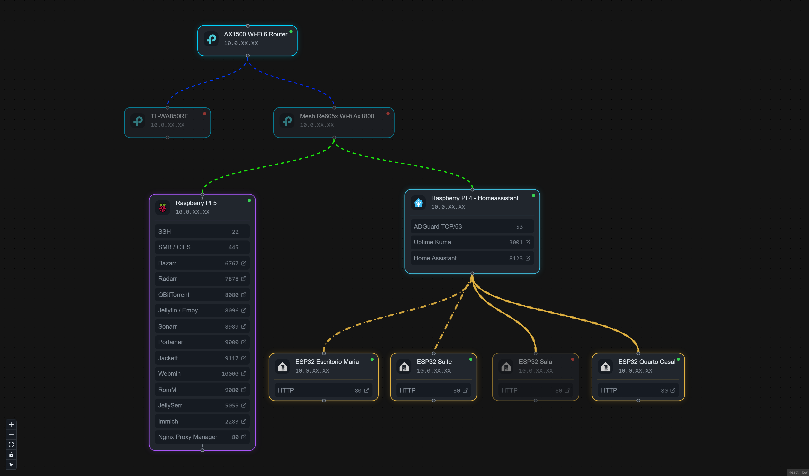

# home-server

Repositório para registrar minha experiência montando e operando um **home server self-hosted**. Aqui documento o que instalei, por que escolhi cada ferramenta e como as peças se encaixam — não é um repositório para armazenar código e configurações.

## Sobre este repositório

Este projeto tem caráter **educativo**, de **contribuição** e **diversão** para entusiastas de automação residencial, mídia, jogos retro, containers e IoT. Os arquivos `docker-compose` e `env.example` presentes aqui são **exemplos ilustrativos** da minha stack em funcionamento — servem como ponto de partida para estudo, não como receita pronta para copiar e colar somente.

Cada ambiente é único: hardware, rede, storage e necessidades diferem. O que funciona aqui pode precisar de adaptação no seu setup.

## Antes de começar

A documentação deste repositório é um **guia rápido**. Para configurar qualquer serviço corretamente, é **imprescindível** que você:

1. **Leia a documentação oficial** de cada aplicação — links incluídos no final de cada documento.
2. **Busque bons tutoriais** no Google e no YouTube.
3. **Entenda os conceitos** por trás de cada ferramenta antes de expor serviços na internet.

O universo de home server é **muito vasto**. Além do que está documentado aqui, existem dezenas de alternativas, integrações e projetos open source igualmente interessantes e úteis — vale explorar, experimentar e compartilhar o que aprender.

## Hardware

A infraestrutura documentada neste repositório roda em **três nós**: dois Raspberry Pi com **8 GB de RAM** e um **Dell OptiPlex 3050 Micro**. Detalhes de placas, HATs PCIe, discos e topologia: [hardware/raspberry_pi/README.md](hardware/raspberry_pi/README.md) · [hardware/dell/README.md](hardware/dell/README.md).

Os ESP32 usados como Bluetooth trackers e captura de IRK na automação residencial estão documentados em [hardware/esp32/README.md](hardware/esp32/README.md) (firmware em [automations/esp32](automations/esp32/README.md)).

### Raspberry Pi 5 — containers e stacks

Hostname: **`raspberrypi`**. Sistema operacional [Debian Trixie 13](https://www.raspberrypi.com/news/trixie-the-new-version-of-raspberry-pi-os/). Armazenamento: **somente NVMe M.2 256 GB**.

Em execução: o **único** [Portainer](apps/portainer/README.md) CE da infra, stacks **admin**, **games**, **immich** e **telemetria**. Inventário detalhado: [hardware/raspberry_pi/pi5/v2](hardware/raspberry_pi/pi5/v2/README.md).

**Referências:** [Raspberry Pi 5](https://www.raspberrypi.com/products/raspberry-pi-5/) · [Introducing Raspberry Pi 5](https://www.raspberrypi.com/news/introducing-raspberry-pi-5/)

### Raspberry Pi 4 — automação residencial

Dedicado ao [Home Assistant](apps/home_assistant/README.md). O HA roda **diretamente no dispositivo como sistema operacional**, no modo **Supervisor** (instalação gerenciada com suporte nativo a apps/add-ons). Sem alteração de inventário Docker neste momento.

**Referência:** [Raspberry Pi 4 Model B](https://www.raspberrypi.com/products/raspberry-pi-4-model-b/)

### Dell OptiPlex 3050 Micro — nó x86

Hostname: **`dell3050`**. Intel Core **i5 de 6ª geração**, **8 GB de RAM**, **HDD de 1 TB**.

Em execução: **portainer-agent** (sem UI — gerenciado pelo CE do Pi 5), stacks **admin**, **stream** e **seafile**. Inventário: [hardware/dell](hardware/dell/README.md).

## Visão geral

O home server combina serviços de infraestrutura, mídia, jogos, arquivos, telemetria e automação, distribuídos assim:

```
raspberrypi (Pi 5)                         dell3050 (OptiPlex 3050 Micro)
├── Portainer CE (única UI) ──agent──►     ├── portainer-agent (sem UI)
├── admin (NPM, tunnel, filebrowser, …)    ├── admin (NPM, tunnel, filebrowser, …)
├── games (RomM)                           ├── stream (*Arr + Jellyfin)
├── immich                                 └── seafile
└── telemetria (Grafana / Influx / MQTT)

Home Assistant (Pi 4)    → monitoramento, HACS (AdGuard removido)
Automations ESP32        → proxies Bluetooth para o HA
```

Cada host tem sua própria `proxy_network`. O **NPM de entrada** é o do **Pi 5** (`*.local` → `10.0.0.x`): apps locais vão direto aos containers; apps no Dell são **repassadas ao NPM do `dell3050`**. Os dois nós têm túnel Cloudflare para exposição na internet. Detalhes: [estratégia entre NPMs](apps/stacks/admin/README.md#estratégia-de-comunicação-entre-os-npms).

| Área               | Função / host                                             |
| ------------------ | --------------------------------------------------------- |
| **Portainer**      | **Só um CE** (Pi 5); Dell gerenciado via **Agent**        |
| **Stacks**         | Serviços por contexto, deploy via Portainer               |
| **Proxy local**    | NPM Pi 5 (entrada) → NPM Dell se a app estiver no x86     |
| **Túneis**         | Cloudflare em Pi 5 e Dell (exposição à internet)          |
| **Stream / Seafile** | Mídia e arquivos sync no Dell (HDD 1 TB)                |
| **Home Assistant** | Automação residencial (Raspberry Pi 4)                    |
| **ESP32**          | Extensão de alcance BLE                                   |




## Documentação


### Infraestrutura


| Documento                             | Descrição                                                      |
| ------------------------------------- | -------------------------------------------------------------- |
| [Portainer](apps/portainer/README.md) | Único CE no Pi 5; Dell via Agent — ponto de partida da infra |


### Stacks Docker


| Stack                                          | Host | Descrição |
| ---------------------------------------------- | ---- | --------- |
| [admin](apps/stacks/admin/README.md) ([pi](apps/stacks/admin/raspberrypi/) · [dell](apps/stacks/admin/dell/)) | Pi 5 + Dell | NPM, Tunnel, Filebrowser, backup; Pi 5 + MCP e MQTT `1883` |
| [stream](apps/stacks/stream/README.md)         | Dell | *Arr + Jellyfin (HW `/dev/dri`) + Seerr + qBit + Jackett + Prowlarr |
| [games](apps/stacks/games/README.md)           | Pi 5 | RomM — gerenciador de ROMs |
| [immich](apps/stacks/immich/README.md)         | Pi 5 | Immich — fotos e vídeos |
| [seafile](apps/stacks/seafile/README.md)       | Dell | Seafile + Seadoc |
| [telemetria](apps/stacks/telemetria/README.md) | Pi 5 | Grafana, InfluxDB, Mosquitto, Telegraf |


### Automação e IoT


| Documento                                                | Descrição                                                |
| -------------------------------------------------------- | -------------------------------------------------------- |
| [Home Assistant](apps/home_assistant/README.md)          | Apps: HACS, Uptime Kuma, Bermuda, Homelable (AdGuard removido) |
| [ESP32 — Hardware](hardware/esp32/README.md)             | DevKit V1, DevKitC V4 e Mini C3 — inventário e specs     |
| [ESP32 — Bluetooth Tracker](automations/esp32/README.md) | Proxies BLE integrados ao Home Assistant via ESPHome     |
| [Dell OptiPlex 3050 Micro](hardware/dell/README.md)      | Nó x86 — i5 6ª gen, 8 GB RAM, HDD 1 TB                   |
| [Raspberry Pi](hardware/raspberry_pi/README.md)          | Pi 5 (M.2 256 GB) e Pi 4 (Home Assistant)                |


## Estrutura do repositório

```
home-server/
├── apps/
│   ├── portainer/           # Gerenciador Docker (iniciado via terminal)
│   ├── home_assistant/      # Documentação dos apps do HA
│   └── stacks/
│       ├── admin/           # Proxy, túnel, Filebrowser, backup (Pi 5 + Dell)
│       │   ├── raspberrypi/ # compose/env admin no Pi 5 (+ MCP, MQTT 1883)
│       │   └── dell/        # compose/env admin no dell3050
│       ├── games/           # Jogos retro (RomM) — Pi 5
│       ├── immich/          # Fotos e vídeos — Pi 5
│       ├── seafile/         # Sync de arquivos — Dell (compose + env)
│       ├── stream/          # Mídia (*Arr + Jellyfin) — Dell
│       └── telemetria/      # Grafana / Influx / MQTT — Pi 5 (compose + env)
├── automations/
│   └── esp32/               # Proxies Bluetooth (ESPHome)
├── hardware/
│   ├── raspberry_pi/        # Placas, HATs PCIe e armazenamento (Pi)
│   ├── dell/                # OptiPlex 3050 Micro (nó x86 + HDD 1 TB)
│   └── esp32/               # DevKits ESP32 (BLE tracker / IRK)
├── shared/                  # Arquivos úteis compartilhados com o repositório
└── README.md
```


## Contribuições

Sugestões, correções e ideias são bem-vindas via issues e pull requests. Se este repositório ajudar alguém a dar os primeiros passos no mundo self-hosted, já cumpriu o objetivo.

---

*Lembre-se: a melhor documentação sempre será a oficial de cada projeto. Este repositório é um mapa da minha jornada — o caminho detalhado, você constrói com as fontes primárias.*