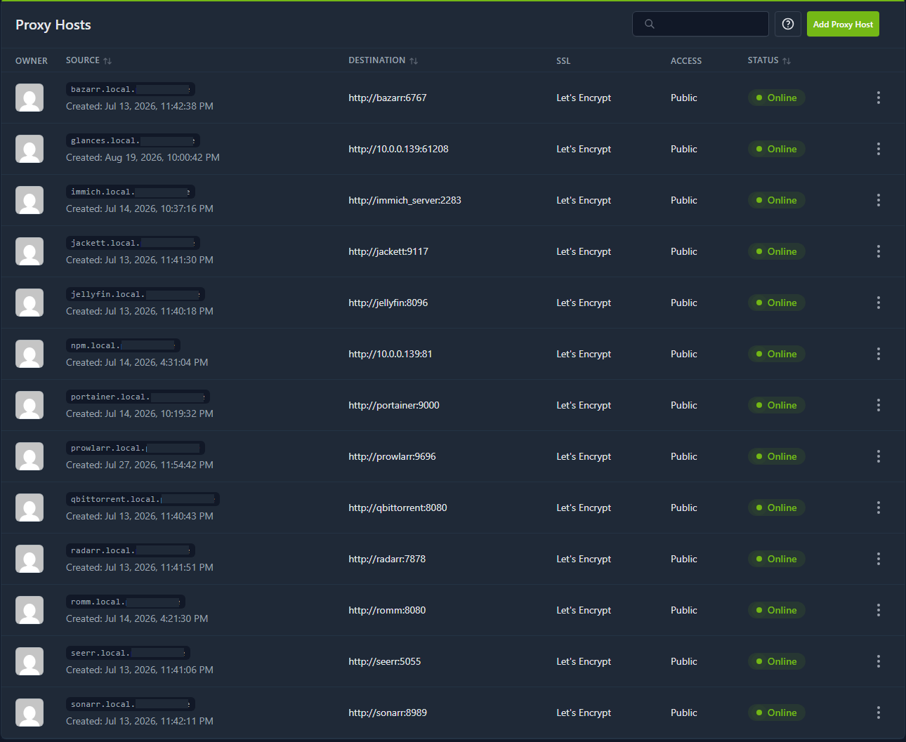

# Admin

Stack de ferramentas administrativas do home server. Reúne o proxy reverso, o backup do gerenciador de containers, o túnel Cloudflare e o [Filebrowser](https://filebrowser.org/).

**Onde roda:** a stack `admin` existe nos **dois** hosts Docker, com conjuntos de apps **diferentes**:

| Host | Hostname | Apps na stack `admin` | Compose neste repo |
| ---- | -------- | --------------------- | ------------------ |
| Raspberry Pi 5 | `raspberrypi` | NPM (entrada + MQTT `1883`), Cloudflare Tunnel, Filebrowser, portainer-backup, **portainer-mcp** | [`raspberrypi/`](./raspberrypi/) |
| Dell OptiPlex 3050 Micro | `dell3050` | NPM, Cloudflare Tunnel, Filebrowser, portainer-backup | [`dell/`](./dell/) |

Cada nó tem a própria rede Docker (`proxy_network` local àquele host). Containers do Pi 5 **não** resolvem por nome containers do Dell (e vice-versa) — por isso o proxy entre máquinas passa pelos NPMs, não pela rede Compose compartilhada.

### Arquivos de exemplo

```
apps/stacks/admin/
├── README.md
├── docker-compose.yaml       # esqueleto genérico legado
├── env.example
├── raspberrypi/              # produção no Pi 5 (entrada *.local + MCP + MQTT)
│   ├── docker-compose.yaml
│   └── env.example
└── dell/                     # produção no dell3050
    ├── docker-compose.yaml
    └── env.example
```


## Estratégia de comunicação entre os NPMs

Há **dois Nginx Proxy Managers**, um em cada máquina. Os papéis são distintos:

| Papel | Host | Função |
| ----- | ---- | ------ |
| **NPM de entrada (fronteira)** | Raspberry Pi 5 (`raspberrypi`, IP estático **10.0.0.x**) | Único ponto de entrada do domínio **local** (`*.local.meudominio.me`). Decide se a app está no próprio Pi 5 ou no Dell. |
| **NPM do Dell (nó remoto)** | `dell3050` | Recebe o repasse do NPM do Pi 5 e entrega a requisição aos containers da `proxy_network` **local do Dell** (stream, seafile, etc.). |

### Domínio local — fluxo pelo Pi 5

No DNS da LAN (ou hosts), o registro do tipo **`*.local.meudominio.me`** aponta para o **Pi 5**. Todo acesso “pela rede de casa” chega primeiro ao NPM de entrada:

1. **App no Pi 5** (RomM, Immich, Portainer, Grafana, …) — o NPM do Pi 5 encaminha direto para o **nome do container** na `proxy_network` local (ex.: `http://immich_server:2283`).
2. **App no Dell** (Jellyfin, Seerr, Seafile, …) — o NPM do Pi 5 **não** alcança esses containers por nome Docker. Em vez disso, o Proxy Host no Pi 5 aponta para o **NPM do Dell** (IP/hostname LAN do `dell3050`, portas `80`/`443`). O NPM do Dell, que enxerga a `proxy_network` daquela máquina, completa o roteamento até o container (ex.: `http://jellyfin:8096`).

```
Cliente (LAN)  →  *.local.meudominio.me  →  NPM Pi 5 (10.0.0.x)
                                              │
                    ┌─────────────────────────┼─────────────────────────┐
                    ▼                         ▼                         │
           App no Pi 5                  App no Dell                     │
           (proxy_network Pi 5)         NPM Dell (LAN)                  │
                                        → proxy_network Dell            │
                                          → jellyfin, seafile, …        │
```

Em outras palavras: o NPM do Pi 5 é o **roteador de hostnames** da casa; o NPM do Dell é um **hop interno** só quando o destino vive no x86.

### Internet — dois túneis Cloudflare

Os **dois** hosts têm `cloudflared` na stack admin. Cada um mantém um túnel Cloudflare e pode expor apps à internet **sem abrir portas de entrada** no roteador. O túnel de cada máquina tipicamente aponta para o **NPM daquele mesmo host** (`http://nginx-proxy-manager:80` na `proxy_network` local), e as rotas públicas são configuradas no dashboard da Cloudflare por hostname.

Isso é independente do fluxo `*.local`:

- **Acesso local** → sempre via NPM do Pi 5 (com repasse ao Dell quando necessário).
- **Acesso pela internet** → via o túnel da máquina onde a app (ou o NPM de destino) está publicado na Cloudflare.

### Por que essa estratégia

- Mantém um **único DNS local** e um **único NPM de entrada** na LAN.
- Evita publicar todas as portas das apps do Dell na rede; só o NPM do Dell precisa ser alcançável pelo Pi 5.
- Cada Docker host continua com sua `proxy_network` isolada — sem overlay multi-host.
- Os túneis Cloudflare permitem expor serviços de qualquer um dos nós sem mudar o desenho local.

## Arquitetura de rede (por host)

Nos containers de cada máquina, em geral **não** se publicam portas no host — exceto o NPM (`80`, `443`, `81`). O tráfego HTTP/HTTPS entre apps do **mesmo** host usa a rede externa `proxy_network` daquele host.

```
── raspberrypi (Pi 5) ────────────────────────────
proxy_network (local)
  ├── nginx-proxy-manager   ← entrada *.local + destino de apps locais
  ├── cloudflared
  ├── filebrowser, portainer-backup, portainer-mcp
  ├── portainer, romm, immich_*, grafana, …
  └── (repasse LAN) ──► NPM do dell3050

── dell3050 ──────────────────────────────────────
proxy_network (local)
  ├── nginx-proxy-manager   ← recebe repasse do Pi 5 / túnel Cloudflare deste nó
  ├── cloudflared
  ├── filebrowser, portainer-backup
  ├── jellyfin, seerr, sonarr, … (stream)
  └── seafile, seadoc, …
```

Antes do primeiro deploy em cada host, a rede externa precisa existir **naquele** Docker:

```bash
docker network create proxy_network
```

Cada stack também mantém uma rede local (`admin_default`, `stream_network`, etc.) para comunicação interna entre containers da mesma stack, sem passar pelo proxy.

## Aplicações

### Nginx Proxy Manager

O [Nginx Proxy Manager](https://nginxproxymanager.com/) (NPM) publica as portas `80`, `443` e `81` no host. Assume o roteamento HTTP/HTTPS e o gerenciamento de certificados (Let's Encrypt).

**No Pi 5 (entrada):**

| Destino da app | Forward Hostname no Proxy Host | Exemplo |
| -------------- | ------------------------------ | ------- |
| Container local | Nome do container na `proxy_network` do Pi 5 | `http://immich_server:2283` |
| Container no Dell | IP/hostname LAN do `dell3050` (NPM remoto) | `http://<ip-dell3050>:80` (o NPM do Dell faz o resto) |

**No Dell (nó remoto):** os Proxy Hosts apontam para o **nome do container** na `proxy_network` local (ex.: `http://jellyfin:8096`, `http://seafile:80`), como em um setup de host único.

No painel (`http://<host>:81`), use sempre a porta **interna** do serviço (não uma porta antiga mapeada no host), salvo no caso do hop Pi 5 → Dell, em que o destino é o próprio NPM remoto.

| Porta no host | Uso | Onde |
| --- | --- | --- |
| `80` | HTTP | Pi 5 e Dell |
| `443` | HTTPS | Pi 5 e Dell |
| `81` | Painel de administração do NPM | Pi 5 e Dell |
| `1883` | MQTT (ex.: Mosquitto da [telemetria](../telemetria/README.md)) | **somente Pi 5** |



**Referência:** [Nginx Proxy Manager — Documentação](https://nginxproxymanager.com/guide/)

### Filebrowser

O [Filebrowser](https://filebrowser.org/) expõe uma interface web para navegar e gerenciar arquivos no host (uploads, downloads, edição básica). Presente na stack `admin` em ambos os nós (`raspberrypi` e `dell3050`).

**Referência:** [Filebrowser](https://filebrowser.org/)

### Portainer MCP (somente Pi 5)

No host `raspberrypi`, a stack admin inclui o [`portainer-mcp`](https://docs.portainer.io/) (`portainer/portainer-mcp:2.45`), expondo ferramentas MCP sobre a API do Portainer CE local (`PORTAINER_URL=http://portainer:9000`).

Transporte HTTP na porta interna `PORTAINER_MCP_HTTP_PORT` (padrão `17717`). O acesso externo passa pelo NPM com **SSL termination**; por isso `PORTAINER_MCP_DANGEROUSLY_ALLOW_PLAINTEXT_HTTP=1` entre NPM e o container. Ajuste `PORTAINER_MCP_ALLOWED_HOSTS` e `PORTAINER_MCP_FORWARDED_ALLOW_IPS` ao hostname e à faixa da `proxy_network`.

### Portainer Backup

Utilitário para automatizar backups do [Portainer](https://www.portainer.io) via API. Conecta-se ao servidor Portainer com um access token e exporta periodicamente o banco de dados da instância em um arquivo `.tar.gz`. Opcionalmente, inclui os arquivos `docker-compose` das stacks criadas na interface web do Portainer.

Nesta stack, o container roda no modo `schedule`, executando backups de forma contínua conforme a expressão cron definida em `PORTAINER_BACKUP_SCHEDULE`. Os arquivos gerados são gravados no volume montado em `/backup` (mapeado para `PORTAINER_BACKUP_HOST_PATH` no host). Como está na `proxy_network`, a URL do Portainer pode usar o hostname do container (por exemplo, `http://portainer:9000`).

**Referência:** [SavageSoftware/portainer-backup](https://github.com/SavageSoftware/portainer-backup)

### Cloudflare Tunnel

O [Cloudflare Tunnel](https://developers.cloudflare.com/tunnel/) conecta serviços locais à rede global da Cloudflare por meio de conexões criptografadas apenas de saída, sem expor IP público nem abrir portas de entrada no firewall. O daemon `cloudflared` mantém um túnel persistente com a Cloudflare, permitindo mapear hostnames públicos para serviços internos.

Há um `cloudflared` em **cada** host (`raspberrypi` e `dell3050`), cada um com o próprio túnel/token. Em ambos, o container participa da `proxy_network` local e o destino típico das rotas no dashboard da Cloudflare é o NPM **daquele** host (`http://nginx-proxy-manager:80`). Assim cada máquina publica na internet o que faz sentido expor a partir dela, enquanto o acesso **local** continua centralizado no NPM do Pi 5 (ver [estratégia entre NPMs](#estratégia-de-comunicação-entre-os-npms)).

**Referência:** [Cloudflare Tunnel — Documentação oficial](https://developers.cloudflare.com/tunnel/)

## Configuração

### Raspberry Pi 5 (`raspberrypi`)

Compose e variáveis em [`raspberrypi/`](./raspberrypi/). NPM de **entrada** da LAN; inclui Filebrowser, portainer-mcp, backup, tunnel e publicação da porta **MQTT `1883`**.

| Variável | Descrição |
| --- | --- |
| `PORTAINER_URL` | URL do Portainer CE local (`http://portainer:9000`) — usada pelo backup e pelo MCP |
| `PORTAINER_MCP_*` | Transporte, porta, hosts permitidos, log e plaintext HTTP atrás do NPM |
| `PORTAINER_BACKUP_TOKEN` / `PORTAINER_BACKUP_*` | Agendamento e destino do backup |
| `CLOUDFLARED_TUNNEL_TOKEN` | Token do túnel Cloudflare **deste** host |
| `FILEBROWSER_*` | Raiz `/srv` e paths de database/config no host |
| `NGINX_PROXY_*` | Dados e Let's Encrypt do NPM |

### Dell (`dell3050`)

Compose e variáveis em [`dell/`](./dell/). Sem MCP e sem porta MQTT no NPM.

| Variável | Descrição |
| --- | --- |
| `CLOUDFLARED_TUNNEL_TOKEN` | Token do túnel Cloudflare **deste** host |
| `PORTAINER_URL` | URL do Portainer CE no Pi 5 (alcançável pela LAN) |
| `PORTAINER_BACKUP_*` / `FILEBROWSER_*` / `NGINX_PROXY_*` | Idem ao Pi 5, paths locais do Dell |

Antes do deploy em cada host: `docker network create proxy_network` (se ainda não existir).

### Exemplo genérico (raiz)

O `docker-compose.yaml` / `env.example` na raiz são um esqueleto legado. Prefira [`raspberrypi/`](./raspberrypi/) e [`dell/`](./dell/) conforme o nó.
