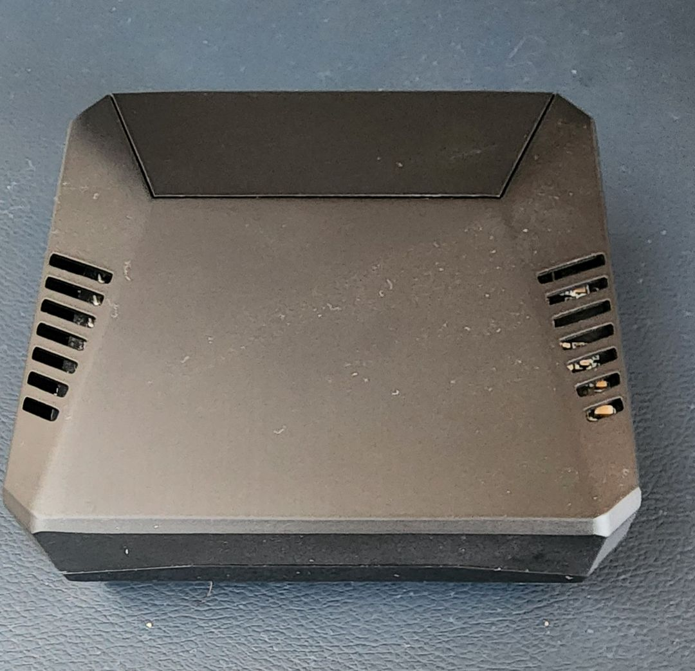
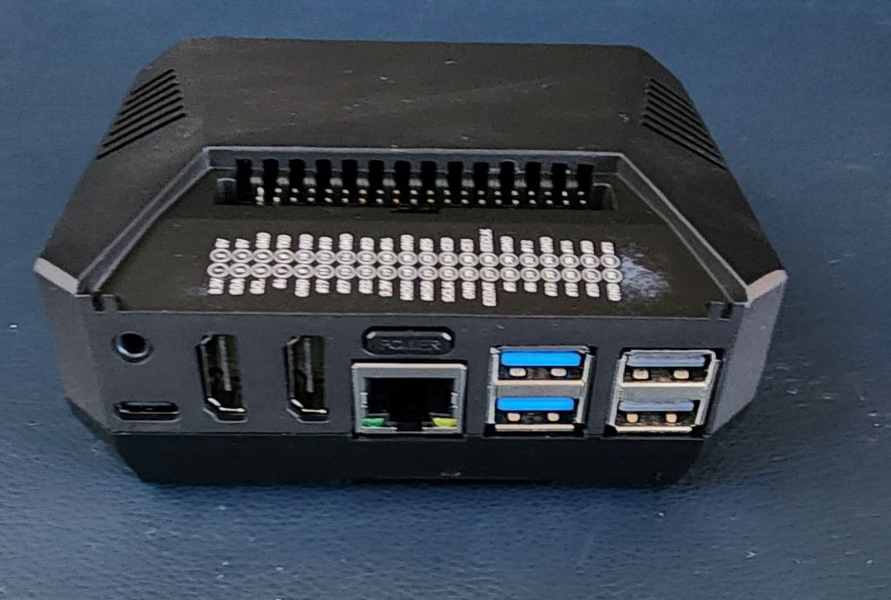
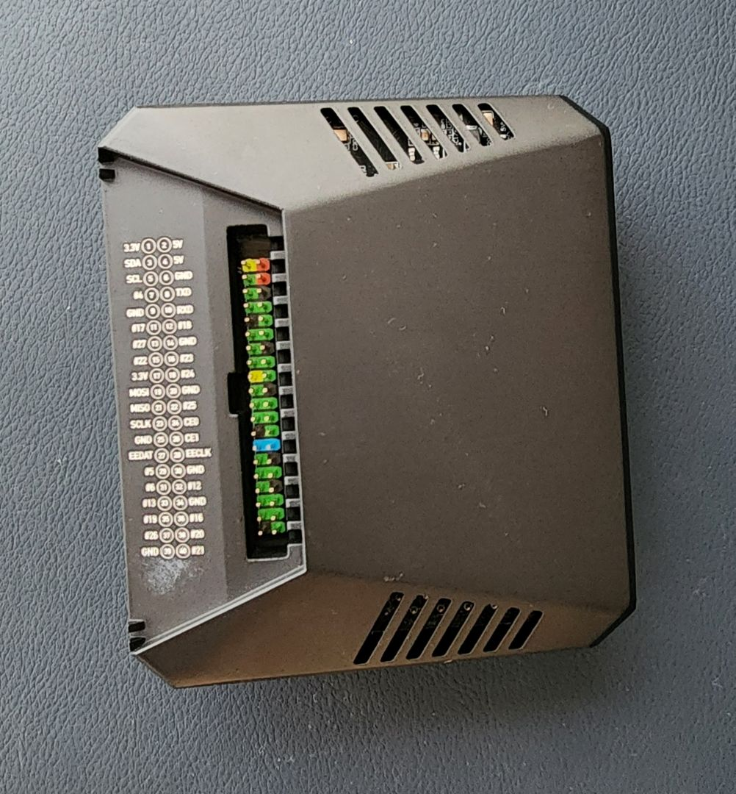

# Raspberry Pi 5


Placa principal da infraestrutura de containers. Roda [Debian Trixie 13](https://www.raspberrypi.com/news/trixie-the-new-version-of-raspberry-pi-os/), hospedando o [Portainer](../../../../apps/portainer/README.md) e as [stacks Docker](../../../../apps/stacks/admin/README.md).

### Especificações da placa

O [Raspberry Pi 5](https://www.raspberrypi.com/products/raspberry-pi-5/) traz: CPU Cortex-A76 quad-core a 2,4 GHz, GPU VideoCore VII, 2× USB 3.0 a 5 Gbps, Ethernet Gigabit, Wi-Fi 802.11ac e, principalmente para este setup, **interface PCIe 2.0 x1** para periféricos de alta velocidade. Mais detalhes no anúncio oficial: [Introducing: Raspberry Pi 5](https://www.raspberrypi.com/news/introducing-raspberry-pi-5/).

### Expansão PCIe — topologia

O setup atual utiliza o case **Argon One v3 M.2 NVMe PCIE**, que integra um HAT PCIe para conexão direta de armazenamento NVMe. O disco de boot (e único disco deste nó) está no slot M.2 do case.

```
Raspberry Pi 5
    │
    └── Argon One v3 M.2 NVMe PCIE Case
        └── Slot M.2 NVMe → NVMe 256 GB [sistema operacional + containers]
```

> **Mudança de topologia:** o HDD de 1 TB que antes ficava no Pi 5 via hub USB com fonte externa foi removido deste nó. O armazenamento em massa passou para o [Dell OptiPlex 3050 Micro](../../../dell/README.md). O Raspberry Pi 5 permanece **somente com o M.2 de 256 GB**, rodando o SO e alguns containers Docker.

#### Argon One v3 M.2 NVMe PCIE Case

Case compacto que inclui um HAT PCIe dedicado para expansão de alta velocidade. Diferente da versão v1, esta montagem simplifica a conexão do disco principal.

- **Manual:** [Argon One v3 Case and M.2 NVMe PCIE Case Manual](https://argon40.com/blogs/argon-resources/argon-one-v3-case-and-m-2-nvme-pcie-case-manual)

#### Armazenamento — NVMe (boot + containers)

O disco está montado diretamente no slot M.2 NVMe integrado ao case Argon One v3.

| Item | Detalhe |
| ---- | ------- |
| **Disco** | M.2 NVMe 256 GB |
| **Função** | Sistema operacional (boot) e containers Docker |
| **Conexão** | Slot M.2 NVMe via HAT PCIe |

### Resumo do Setup Atual

| Disco | Interface | Capacidade | Função |
| ----- | --------- | ---------- | ------ |
| M.2 NVMe | PCIe (Argon One v3) | 256 GB | Sistema operacional + containers |

### Containers em execução

Hostname na rede: **`raspberrypi`** (este é o **Raspberry Pi 5**). Inventário a partir de `docker compose ls` / `docker ps`. O Raspberry Pi 4 (Home Assistant) **não** está incluído nesta lista.

Este host concentra o **NPM de entrada** da LAN (`*.local` → IP estático **10.0.0.x**): proxy direto para containers locais e repasse ao NPM do Dell quando a app está no x86. Também tem túnel Cloudflare próprio. Ver [estratégia entre NPMs](../../../../apps/stacks/admin/README.md#estratégia-de-comunicação-entre-os-npms).

| Stack / origem | Containers | Papel |
| -------------- | ---------- | ----- |
| **portainer** | `portainer` | **Único** Portainer CE da infra — gerencia o Docker local e o Dell via Agent |
| **admin** | `nginx-proxy-manager`, `cloudflared_tunnel`, `filebrowser`, `portainer-backup`, `portainer-mcp` | Proxy, túnel, Filebrowser, backup e MCP do Portainer |
| **games** | `romm`, `romm-db` | Gerenciador de ROMs |
| **immich** | `immich_server`, `immich_machine_learning`, `immich_postgres`, `immich_redis` | Fotos e vídeos |
| **telemetria** | `telemetria-grafana-1`, `telemetria-influxdb-1`, `telemetria-mosquitto-1`, `telemetria-telegraf-1` | Observabilidade (Grafana, InfluxDB, Mosquitto, Telegraf) |

```
raspberrypi (Pi 5)
├── portainer                → Portainer CE (compose standalone)
├── admin                    → NPM, Cloudflare Tunnel, Filebrowser, portainer-backup, portainer-mcp
├── games                    → RomM + MariaDB
├── immich                   → Immich (server, ML, Postgres, Redis/Valkey)
└── telemetria               → Grafana + InfluxDB + Mosquitto + Telegraf
```

A stack **stream** e o **Seafile** rodam no [Dell OptiPlex 3050 Micro](../../../dell/README.md) (`dell3050`), não neste nó.

Documentação: [Portainer](../../../../apps/portainer/README.md) · [admin](../../../../apps/stacks/admin/README.md) · [compose admin no Pi 5](../../../../apps/stacks/admin/raspberrypi/) · [games](../../../../apps/stacks/games/README.md) · [immich](../../../../apps/stacks/immich/README.md) · [telemetria](../../../../apps/stacks/telemetria/) (compose + env).

---

## Referências

### Hardware e Cases
- [Argon One v3 M.2 NVMe PCIE Case Manual](https://argon40.com/blogs/argon-resources/argon-one-v3-case-and-m-2-nvme-pcie-case-manual)

### Comparativo de Periféricos
- [Configuração v1 (Waveshare + Geekworm)](../v1/README.md)

### Outros nós
- [Dell OptiPlex 3050 Micro](../../../dell/README.md) — HDD 1 TB (stream, seafile, admin, portainer-agent)

### Imagens do Hardware



